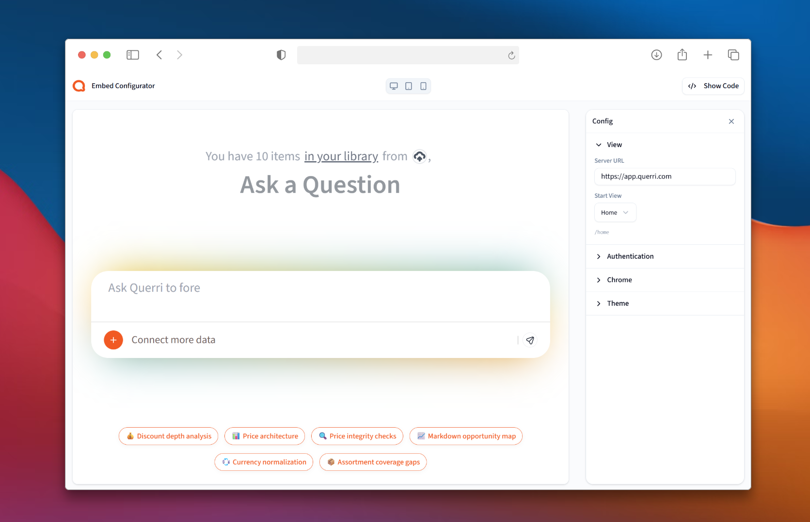
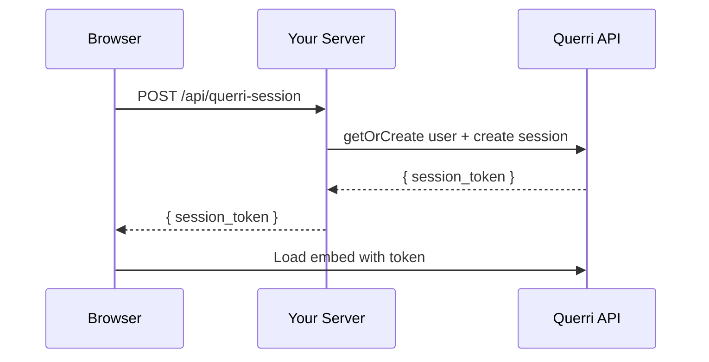

# @querri-inc/embed

> Embed Querri analytics in your app. Zero dependencies. Works everywhere.

**React** | **Vue** | **Svelte** | **Angular** | **Vanilla JS** | **CDN**



Querri Embed drops a full analytics experience into your app — dashboards, reports, and data exploration — with built-in authentication, per-user access control, UI customization, and theming. One component, one server endpoint, zero dependencies.

## Get Started in 60 Seconds

### 1. Install

```bash
npm install @querri-inc/embed
```

### 2. Add the embed

```tsx
import { QuerriEmbed } from '@querri-inc/embed/react';

<QuerriEmbed
  style={{ width: '100%', height: '600px' }}
  serverUrl="https://app.querri.com"
  auth={{ sessionEndpoint: '/api/querri-session' }}
/>
```

> Using Vue, Svelte, Angular, or Vanilla JS? See [Framework Examples](#framework-examples) below.

> The `auth` prop supports multiple modes: server tokens, share keys, and popup login. See [Authentication Modes](#authentication-modes) for all options.

### 3. Create a session endpoint

> Only needed for server-token auth (`sessionEndpoint` or `fetchSessionToken`). Skip this step if using [Share Key](#share-key-public-embeds) or [Popup Login](#popup-login-user-accounts).

```typescript
// app/api/querri-session/route.ts
import { createSessionHandler } from '@querri-inc/embed/server/nextjs';

export const POST = createSessionHandler();
```

Set `QUERRI_API_KEY` and `QUERRI_ORG_ID` [environment variables](#environment-variables).

> `createSessionHandler()` creates an anonymous session. To map sessions to your authenticated users, use [`resolveParams`](#quick-start) in the Server SDK section.

> Using a different framework? See the [Server SDK](#server-sdk) section for all framework handlers.

### 4. Done.

The embed handles auth, token caching, and cleanup automatically.



## Framework Examples

**React**

```tsx
import { QuerriEmbed } from '@querri-inc/embed/react';

<QuerriEmbed
  style={{ width: '100%', height: '600px' }}
  serverUrl="https://app.querri.com"
  auth={auth}
  startView="/dashboard/uuid"
/>
```

**Vue**

```vue
<template>
  <div style="width: 100%; height: 600px">
    <QuerriEmbed server-url="https://app.querri.com" :auth="auth" start-view="/dashboard/uuid" />
  </div>
</template>
<script setup>
import { QuerriEmbed } from '@querri-inc/embed/vue';
const auth = { shareKey: 'your-share-key', org: 'your-org-id' };
</script>
```

**Svelte**

```svelte
<script>
  import QuerriEmbed from '@querri-inc/embed/svelte';
  const auth = { shareKey: 'your-share-key', org: 'your-org-id' };
</script>
<div style="width: 100%; height: 600px">
  <QuerriEmbed serverUrl="https://app.querri.com" {auth} startView="/dashboard/uuid" />
</div>
```

**Angular**

```typescript
import { Component } from '@angular/core';
import { QuerriEmbedComponent } from '@querri-inc/embed/angular';

@Component({
  standalone: true,
  imports: [QuerriEmbedComponent],
  template: `<div style="width: 100%; height: 600px">
    <querri-embed [serverUrl]="'https://app.querri.com'" [auth]="auth" [startView]="'/dashboard/uuid'" />
  </div>`,
})
export class DashboardComponent {
  auth = { shareKey: 'your-share-key', org: 'your-org-id' };
}
```

**Vanilla JS**

```javascript
import { QuerriEmbed } from '@querri-inc/embed';

QuerriEmbed.create('#container', {
  serverUrl: 'https://app.querri.com',
  auth: { shareKey: 'your-share-key', org: 'your-org-id' },
  startView: '/dashboard/uuid',
});
```

**CDN**

```html
<!-- The canonical script tag: served by YOUR Querri deployment, so it can never
     version-skew against the product. (This same file is the build of this
     package's core.) -->
<script src="https://app.querri.com/sdk/querri-embed.js"></script>
<script>
  QuerriEmbed.create('#container', {
    serverUrl: 'https://app.querri.com',
    auth: { shareKey: 'your-share-key', org: 'your-org-id' },
  });
</script>
```

## Authentication Modes

### Share Key (Public Embeds)

For publicly shared dashboards. No user login required.

```javascript
auth: {
  shareKey: 'abc123',  // From your dashboard's share link
  org: 'org_456',      // Your organization ID
}
```

### Server Token (Enterprise)

Your backend exchanges an API key for a session token. Point the embed at your session endpoint:

```javascript
auth: {
  sessionEndpoint: '/api/querri-session',
}
```

The SDK POSTs to this URL and extracts `session_token` from the JSON response automatically. A failed request is tried 3 times in all (retries after 1s and 2s); a 4xx answer other than 408 and 429 is a deliberate refusal (e.g. `role_disabled`) and is not retried — `token_fetch_failed` fires at once with its `detail`.

For full control over the request, use a callback instead:

```javascript
auth: {
  fetchSessionToken: async () => {
    const res = await fetch('/api/querri-session');
    const { session_token } = await res.json();
    return session_token;
  },
}
```

### Popup Login (User Accounts)

Users authenticate via a popup window. Session tokens are cached in localStorage.

```javascript
auth: 'login'
```

## Options

| Option | Type | Required | Description |
|--------|------|----------|-------------|
| `serverUrl` | `string` | Yes | Querri server URL, e.g. `'https://app.querri.com'`. (The old `'…/builder'` suffix is obsolete — one URL serves everything.) |
| `auth` | `QuerriAuth` | Yes | Authentication mode (see above) |
| `startView` | `string` | No | Initial view path (e.g. `'/dashboard/uuid'`, `'/inbox'`). Unset opens `'/home'`, the runtime's default view (the home launcher). |
| `chrome` | `QuerriChromeConfig` | No | UI chrome config — the **v2 vocabulary** (`rail`, `header`, `chat`, `global`, `library`, `projects`, `dashboard`, `xls`, `print`, `settings`), ~180 keys, typed from the runtime's own schema. See `{serverUrl}/sdk/README.md` for the full per-key table, or `{serverUrl}/sdk/chrome-schema.json` for the machine-readable schema. Legacy v1 keys (`sidebar.*`, `chat.connectData`, …) are still accepted — the runtime translates them one-way; unknown keys are dropped and reported via the `config` event. |
| `theme` | `QuerriThemeConfig` | No | `{ name?: '' \| 'querri' \| 'querri-dark' \| 'night', colors?, radius?, fontFamily? }`. `colors` keys must be `--ui-*` tokens (allow-listed by the runtime). The old `scheme` key is dead — use `name`. |
| `privacy` | `QuerriPrivacyConfig` | No | `{ sessionReplay?, identify?, errorReporting? }` — analytics consent for your end-users (replay and identify default **off**). |
| `locale` | `string` | No | Language override, e.g. `'en'`, `'es'`. |
| `autoHeight` | `boolean` | No | Grow the iframe to the embed's reported height (`resize` events). |
| `readyTimeout` | `number` | No | Ms to wait for the iframe before warning (default `30000`, `0` disables). The warning is `recoverable: true` and is retracted via the `recovered` event if the embed arrives late. `timeout` is a deprecated alias. |

**Gotchas worth knowing:**
- Legacy `chrome.chat.connectData` maps to a **rail item** now — it does nothing unless the rail is shown (`chrome: { rail: { show: true } }` or legacy `sidebar.show: true`).
- Legacy `chrome.header.{viewModeToggle,share,print,automate,settings,menu}` default **false** in v2 (the old docs said true) and only reach share-key embeds' legacy chat page.
- Legacy `chat.skills` and `theme.scheme` are **dropped** — the runtime reports the former in the `config` event's `changes.dropped`; use `theme.name` for the latter.
- `updateConfig()` **replaces** the config (not a merge): send the whole object each time so keys returned to defaults actually reset.

Listen to the `config` event to see what the runtime did with your config:

```javascript
querri.on('config', function (report) {
  // report.changes.dropped — keys the runtime doesn't know, and values it
  //   refused: each entry is { path, reason }, e.g. reason 'unsafe CSS value'
  //   (a theme colour) or 'not an http(s) URL' (a link or image URL)
  // report.changes.coupled — keys it turned off because a parent is off
  // report.changes.upgraded — legacy keys translated to v2
  console.log('applied at schema v' + report.schemaVersion, report.changes);
});
```

## Events

| Event | Payload | Description |
|-------|---------|-------------|
| `ready` | `{}` | Embed authenticated and ready. Emitted again after a re-authentication (the embed posts `authenticated` once the fresh token is accepted). |
| `error` | `{ code, message, recoverable?, status?, detail? }` | An error occurred. See [Error Codes](#error-codes). |
| `session-expired` | `{}` | Session token expired. Fires once per expired token; in `sessionEndpoint` / `fetchSessionToken` mode the SDK then fetches a new token by itself. |
| `navigation` | `{ type, path?, ... }` | User navigated within the embed |
| `config` | `{ schemaVersion, changes }` | What the runtime applied from your `chrome` / `theme` (see above) |
| `resize` | `{ height }` | Content height in CSS pixels (drives `autoHeight`) |
| `chat` | `{ phase, ... }` | Chat lifecycle: sent / finished / error |
| `recovered` | `{ code, afterMs? }` | Retracts an earlier `recoverable` error (e.g. `timeout`) |

```javascript
// Example: handling events
instance.on('error', ({ code, message }) => {
  console.error(`Querri error [${code}]: ${message}`);
});

instance.on('navigation', ({ type, path }) => {
  console.log('Navigated to:', path);
});
```

### Error Codes

| Code | Meaning |
|------|---------|
| `invalid_auth` | Auth config is invalid |
| `invalid_share_key` | The share key is not valid for this organization, or has expired |
| `invalid_start_view` | `startView` is not a relative path starting with `/` |
| `token_fetch_failed` | `fetchSessionToken` callback (or `sessionEndpoint` request) failed after 3 attempts (retries after 1s and 2s). In `sessionEndpoint` mode an error response adds `detail: { status, code?, permission?, reason? }` read from the endpoint's JSON, and a 4xx other than 408/429 is not retried (the event fires after the first answer). |
| `token_fetch_exhausted` | The token was refetched 3 cycles in a row without the embed accepting it; the SDK stops retrying |
| `popup_blocked` | Browser blocked the login popup |
| `auth_failed` | Authentication failed after popup login |
| `auth_required` | Auth required but no login mode configured |
| `auth_timeout` | The embed received `init` but authentication did not finish within 20s (`recoverable`) |
| `init_timeout` | The embed received no `init` within 20s (`recoverable`) |
| `validation_failed` | The embed could not validate the session token |
| `navigation_failed` | The embed could not navigate to `startView` |
| `timeout` | Iframe didn't respond within `readyTimeout` (default 30s; `recoverable`) |
| `send_prompt_failed` | `sendPrompt()` failed — embed not ready, text empty, or current view has no prompt input |
| `view_error` | A page inside the embed failed to render; `status` carries its HTTP status |
| `preview_escaped` | Embed configurator preview only: the preview navigated outside the embed and is being rebuilt (`recoverable`) |

## Instance API

```javascript
const querri = QuerriEmbed.create('#container', options);

querri.on('ready', callback);     // Subscribe to event (chainable)
querri.off('ready', callback);    // Unsubscribe (chainable)
querri.sendPrompt(text, options); // Set or submit text in the chat prompt
querri.destroy();                 // Clean up iframe and listeners

querri.ready;    // boolean -- true when authenticated
querri.iframe;   // HTMLIFrameElement | null

QuerriEmbed.version;  // SDK version string (e.g. '0.1.0')
```

### `sendPrompt(text, options?)`

Programmatically set text in the embedded chat prompt, or submit it directly.

```javascript
// Place text in the prompt panel for the user to review and send
querri.sendPrompt('What were my sales last quarter?');

// Submit immediately without displaying in the prompt panel
querri.sendPrompt('What were my sales last quarter?', { autoSubmit: true });
```

| Option | Type | Default | Description |
|--------|------|---------|-------------|
| `autoSubmit` | `boolean` | `false` | If `true`, submit the prompt immediately without showing it in the input |

Requires `ready` to be `true`. Emits an `error` event with code `send_prompt_failed` if the embed is not ready, the text is empty, or the current view has no prompt input.

## Framework Component API

### React

The React component accepts all SDK options as props, plus:

| Prop | Type | Description |
|------|------|-------------|
| `className` | `string` | CSS class for the container div |
| `style` | `CSSProperties` | Inline styles for the container div |
| `onReady` | `() => void` | Ready callback |
| `onError` | `(err) => void` | Error callback |
| `onSessionExpired` | `() => void` | Session expired callback |
| `onNavigation` | `(data) => void` | Navigation callback |

Access the underlying instance via ref:

```tsx
import { useRef } from 'react';
import { QuerriEmbed, type QuerriEmbedRef } from '@querri-inc/embed/react';

const ref = useRef<QuerriEmbedRef>(null);
// ref.current.instance -- SDK instance
// ref.current.iframe -- iframe element
<QuerriEmbed ref={ref} ... />
```

### Vue

Events: `@ready`, `@error`, `@session-expired`, `@navigation`

Access the underlying instance via template ref:

```vue
<QuerriEmbed ref="embedRef" ... />
<!-- embedRef.instance / embedRef.iframe -->
```

### Svelte

Events: `on:ready`, `on:error`, `on:session-expired`, `on:navigation`

Svelte delivers each payload as the event's `detail`: in `on:error`, `e.detail` is the `QuerriErrorEvent` (`e.detail.code`, `e.detail.message`), and the error's own `detail` (e.g. a `sessionEndpoint` refusal) is `e.detail.detail`. The types are exported from `@querri-inc/embed/svelte` (`QuerriErrorEvent`, `QuerriErrorDetail`, `QuerriErrorCode`, …).

```svelte
<QuerriEmbed on:error={(e) => console.log(e.detail.code, e.detail.detail)} ... />
```

Access the underlying instance via `bind:this`:

```svelte
<QuerriEmbed bind:this={embed} ... />
<!-- embed.getInstance() / embed.getIframe() -->
```

### Angular

Inputs: `serverUrl`, `auth`, `startView`, `chrome`, `theme`

Events: `(ready)`, `(error)`, `(sessionExpired)`, `(navigation)`

Access the underlying instance via a template ref or `ViewChild`:

```typescript
@ViewChild(QuerriEmbedComponent) embed!: QuerriEmbedComponent;
// embed.sdkInstance -- SDK instance
// embed.iframe -- iframe element
```

## Server SDK

The server SDK is included in `@querri-inc/embed` -- no extra package required. Use it to create embed session tokens, manage users, enforce access policies, and interact with the full Querri API from your backend. Most apps only need a one-liner session handler.

### Quick Start

Import `createSessionHandler` from your framework's sub-path and export a route handler:

```typescript
// Next.js -- app/api/querri-session/route.ts
import { createSessionHandler } from '@querri-inc/embed/server/nextjs';
export const POST = createSessionHandler();

// SvelteKit -- src/routes/api/querri-session/+server.ts
import { createSessionHandler } from '@querri-inc/embed/server/sveltekit';
export const POST = createSessionHandler();

// React Router v7 -- app/routes/api.querri-session.ts
import { createSessionHandler } from '@querri-inc/embed/server/react-router';
export const action = createSessionHandler();

// Nuxt -- server/api/querri-session.post.ts
import { createSessionHandler } from '@querri-inc/embed/server/nuxt';
export default createSessionHandler();

// Express -- server.ts
import { createSessionHandler } from '@querri-inc/embed/server/express';
app.post('/api/querri-session', createSessionHandler());
```

Pass a `resolveParams` callback to extract user identity from your auth system instead of reading the request body directly:

```typescript
// Next.js -- app/api/querri-session/route.ts
import { createSessionHandler } from '@querri-inc/embed/server/nextjs';
import { getServerSession } from 'next-auth';

export const POST = createSessionHandler({
  resolveParams: async (req) => {
    const session = await getServerSession();
    return {
      user: { external_id: session!.user!.id, email: session!.user!.email! },
      access: { sources: ['src_sales'], filters: { tenant_id: session!.user!.orgId } },
    };
  },
});
```

If you omit `resolveParams`, the handler creates an anonymous session.

> **Security:** Always derive user identity, access and `role` from your server-side auth system. Never read `user`, `access` or `role` from the request body — a malicious client can impersonate any user or escalate access. The browser SDK's `sessionEndpoint` mode POSTs with no body on purpose.

### Custom Roles

Return a `role` (role id or key) from `resolveParams`, or pass it to `getSession()`, to run the embed session as that Custom Role. The result carries the applied `role_id` — `null` when no role was requested, and also when the server is too old to know Custom Roles (it ignores `role` and the session runs as the user's own role), so check `role_id` when the role matters:

```typescript
const session = await client.getSession({ user: 'ext_alice', role: 'analyst' });
session.role_id; // 'role_…' (custom role) or a built-in id such as 'system:creator'
```

`role` is sent only when it is a non-empty string; `null` and `''` mean no role. The user is created/updated and their access policies applied before the session is requested, so if the role is refused those earlier steps have still happened.

`role` is different from `user.role`, which is the user's org role (`admin` / `member`) used when the user is first created. A role the user already holds is simply selected; granting one they do not hold needs a key with the `embed:role:assign` scope (included in `*`), the role on the org's embed allowlist (Settings → Embed), and the people the key acts for must hold every permission the role grants — on servers released after 2026-10-21, both the key's creator and its bound user; before, its bound user (else its creator). Otherwise the grant is refused with `role_not_allowed`.

**A grant is permanent:** it adds the role to the user's role assignment, so later sessions and the Querri app see it too. Revoking the session does not remove it; an admin removes it in Settings → People.

Calls made through `client.asUser(session)` are subject to the session's role. See [docs/server-sdk.md](docs/server-sdk.md#custom-role-role).

### Errors

API failures throw a subclass of `APIError` (`AuthenticationError`, `PermissionError`, `NotFoundError`, `ValidationError`, …) carrying the server's `code`, `message`, `docUrl` and `requestId`. A role-system refusal is a `PermissionError` with `code: 'permission_denied'` plus `permission` and `reason`. `reason` is one of `role_denied`, `not_in_plan`, `flag_off`, `embed_disabled`, `dependency_unmet`, `forbidden` or `scope_exceeds_role` (creating an API key with scopes its creator or bound user lacks); the server may add more (type: `PermissionDeniedReason`). Compare codes with the exported (frozen) `ERROR_CODES` — the codes for authentication, access, Custom Roles, embed sessions and user changes, plus `invalid_parameters`; the API sends other codes too (e.g. `project_not_found`), so treat `code` as a string. Extra fields a refusal lists stay in the raw body: the refused scopes of a `scope_exceeds_role` are `err.body.detail.error.scopes`.

On servers released after 2026-10-21, `users.create()`, `users.update()`, `users.del()` and `users.getOrCreate()` — and so `getSession()` for a new user — can be refused with 403 `escalation_denied` (the change would grant permissions the caller lacks; they are listed in `err.body.detail.error.missing`) or 409 `last_admin` (it would remove the organization's last Admin):

```typescript
import { PermissionError, ERROR_CODES } from '@querri-inc/embed/server';

try {
  await client.getSession({ user: 'ext_alice', role: 'analyst' });
} catch (err) {
  if (err instanceof PermissionError && err.code === ERROR_CODES.ROLE_DISABLED) {
    // the role is a draft; an admin must enable it
  }
}
```

The session handlers answer a refusal with Querri's status and `{ error, code, permission?, reason?, doc_url? }`. Code table: [docs/server-sdk.md](docs/server-sdk.md#error-codes).

### Environment Variables

| Variable | Description | Default |
|---|---|---|
| `QUERRI_API_KEY` | API key (`qk_*` format) | -- |
| `QUERRI_ORG_ID` | Organization / tenant ID | -- |
| `QUERRI_URL` | API host URL | `https://app.querri.com` |

### Manual Setup

For custom servers or advanced use cases where you need the full Querri client API:

```typescript
import { Querri } from '@querri-inc/embed/server';

const client = new Querri('qk_your_api_key');

const { session_token, expires_in } = await client.getSession({
  user: {
    external_id: 'usr_alice',
    email: 'alice@example.com',
  },
  access: {
    sources: ['src_sales'],
    filters: { tenant_id: 'acme' },
  },
  ttl: 3600,
  origin: 'https://myapp.com',
});
```

### Per-User Filtering

Pass `user_id` to get FGA-filtered results for a specific user:

```typescript
// List only projects the user has access to
const projects = await client.projects.list({ user_id: 'ext_alice' });
```

For a full user-scoped client (multiple operations with session auth), use `asUser()`:

```typescript
const session = await client.getSession({ user: 'ext_alice' });
const userClient = client.asUser(session);

const projects = await userClient.projects.list(); // FGA-filtered
```

### Available Resources

The client exposes these resource namespaces: `users`, `embed`, `policies`, `projects`, `chats`, `dashboards`, `data`, `files`, `sources`, `keys`, `sharing`, `audit`, `usage`.

### Full Reference

See **[docs/server-sdk.md](docs/server-sdk.md)** for complete API documentation, including every method signature, pagination, streaming, error handling, and detailed framework integration guides.

For raw HTTP integration without the SDK, see **[docs/api-guide.md](docs/api-guide.md)**.

## Troubleshooting

### Embed is blank or has zero height

Your container needs explicit dimensions. Add `style="width: 100%; height: 600px"` to the container element.

### "Missing API key" error

Set the `QUERRI_API_KEY` environment variable. An org admin creates API keys at https://app.querri.com/settings/api.

### `timeout` -- iframe didn't respond

Check that `serverUrl` is correct and the Querri server is reachable. The default budget is 30
seconds (measured: ~25s on Fast 3G — the whole app boots inside that window), the error carries
`recoverable: true`, and if the embed arrives late the SDK emits `recovered` — so treat `timeout`
as a warning, not a terminal failure:

```javascript
querri.on('error', function (e) {
  if (e.code === 'timeout' && e.recoverable) showSpinnerNote('Still loading…');
});
querri.on('recovered', function () { clearSpinnerNote(); });
```

`readyTimeout: 0` disables the warning entirely.

### `popup_blocked`

The login popup requires a user gesture (e.g., a button click). Browsers block popups triggered without user interaction.

### `token_fetch_failed`

Your `fetchSessionToken` callback (or `sessionEndpoint` fetch) failed after 3 attempts (retries after 1s and 2s). In `sessionEndpoint` mode a 4xx answer other than 408 and 429 is not retried: the event fires after the first answer. Verify that your server endpoint returns `{ session_token: "..." }` as JSON and is reachable.

In `sessionEndpoint` mode, when your endpoint answers with an error status the event carries `detail`: the status plus the `code`, `permission` and `reason` from its JSON (the server SDK's handlers send these; for the Nuxt handler they are read from h3's `data`). For example a draft Custom Role reports:

```javascript
querri.on('error', function (e) {
  if (e.code === 'token_fetch_failed' && e.detail) {
    console.log(e.detail); // { status: 403, code: 'role_disabled' }
  }
});
```

### `send_prompt_failed`

`sendPrompt()` could not deliver the text. Common causes:
- The embed is not yet `ready` (wait for the `ready` event before calling `sendPrompt`).
- The `text` argument is empty or not a string.
- The current view has no chat prompt input (e.g., the user is viewing a dashboard instead of the chat).

## TypeScript

All types are exported from every entry point:

```typescript
import type {
  QuerriAuth,
  QuerriShareKeyAuth,
  QuerriTokenAuth,
  QuerriSessionEndpointAuth,
  QuerriChromeConfig,
  QuerriEmbedOptions,
  QuerriInstance,
  QuerriEventType,
  QuerriEventCallback,
  QuerriErrorEvent,
  QuerriErrorDetail,
  QuerriNavigationEvent,
  SendPromptOptions,
} from '@querri-inc/embed';

// Framework wrappers re-export all core types, plus their own:
import type { QuerriEmbedProps, QuerriEmbedRef } from '@querri-inc/embed/react';
```

## Requirements

The core SDK has **zero dependencies** and works in any modern browser.

Framework wrappers require:

| Framework | Minimum Version |
|-----------|----------------|
| React | >= 17 |
| Vue | >= 3.2 |
| Svelte | >= 4 |
| Angular | >= 17 |

All framework dependencies are optional -- install only what you use.

## Important Notes

- **React/Vue/Angular:** Memoize the `auth` prop if it's an object. A new object reference on every render/change detection cycle will cause the iframe to be destroyed and recreated.
- All framework wrappers automatically clean up the iframe on unmount.

## License

MIT

## Support policy

Versions below 1.0.0 receive security fixes only, for 6 months from the 1.0.0 release (2026-08-31). They speak the pre-v2 embed protocol; migrate with [docs/MIGRATION.md](docs/MIGRATION.md).
